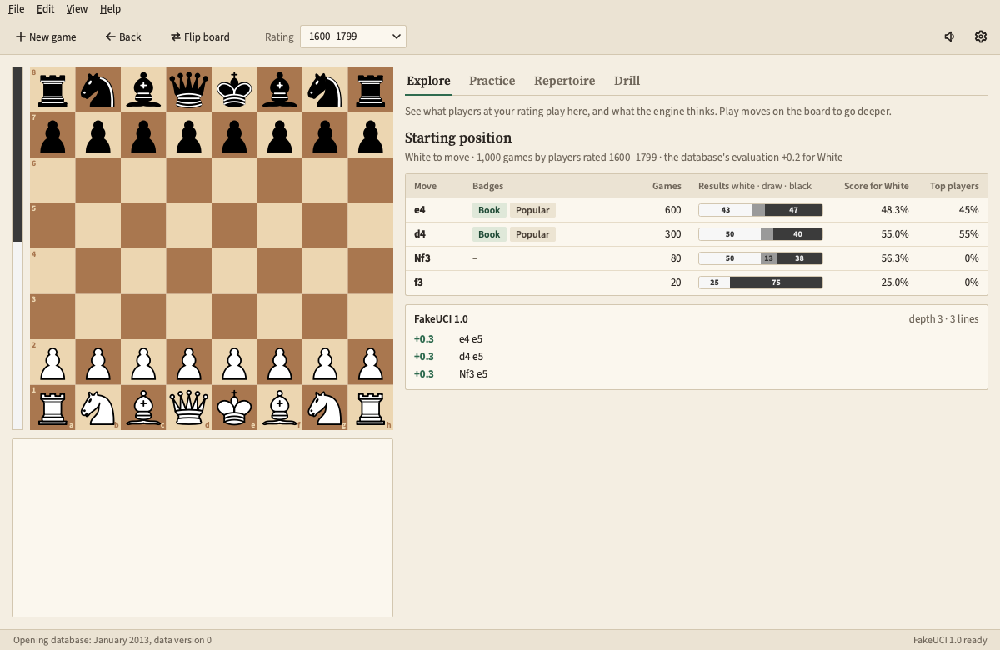
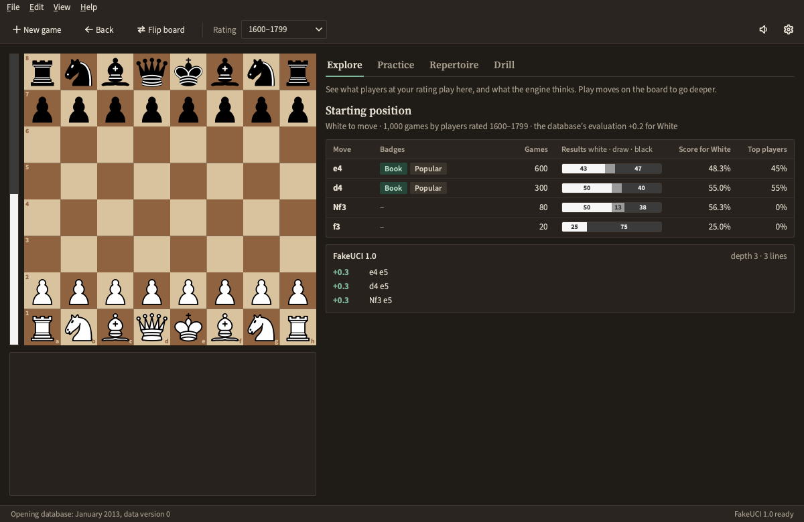
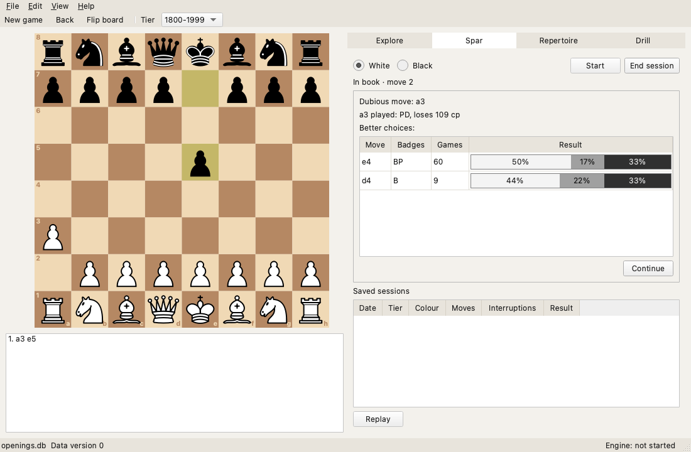
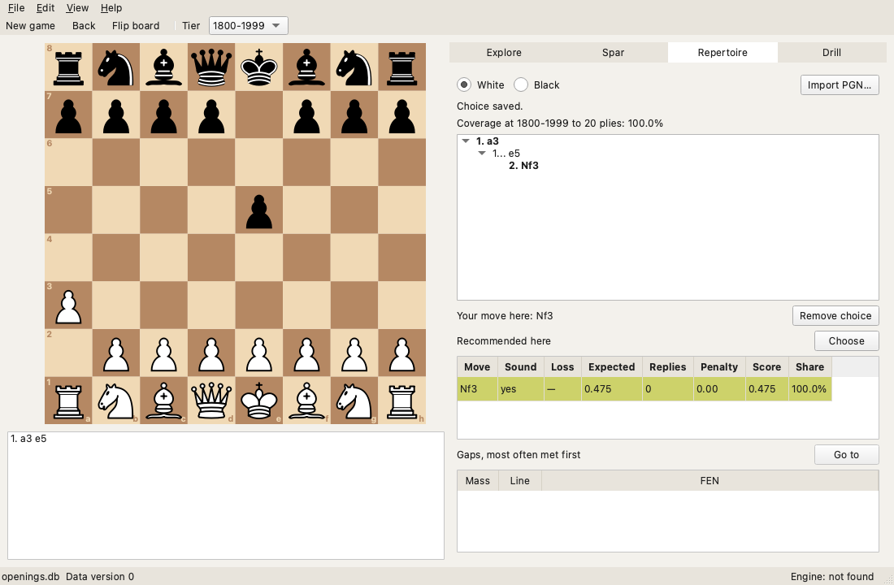
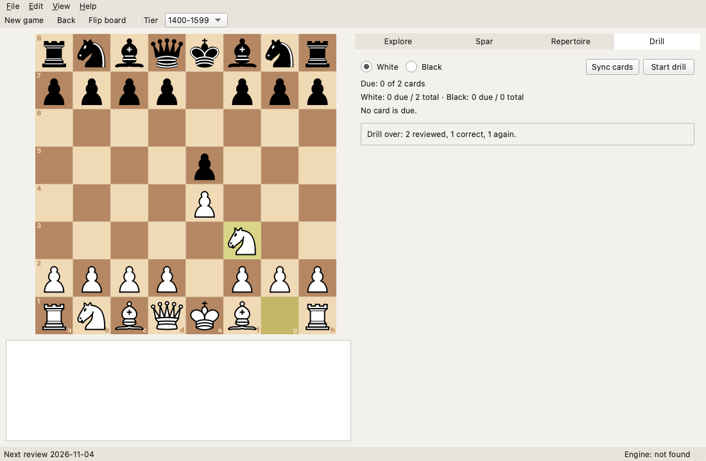

# chess-coach

An offline desktop chess opening coach. It reads an opening database that its own pipeline builds
from the Lichess monthly game dumps, split into seven rating tiers, so that a 1200 and a 2200 each
see what is played and what works at their level, with every move badged Book, Popular or
Dubious from how often it is played, at the tier and at the top tier, and from the engine's
evaluation. A local Stockfish evaluates whatever is off book. There is no account and no network
connection, ever. Built with C++20, Qt 6 Widgets, CMake with vcpkg and SQLite; packaged for
macOS, and it also builds and passes its tests on Linux. MIT-licensed; `chess-coach` is a working
name.

## Status

As of 4 November 2026: version 1.0.0, awaiting its tag. The pipeline builds the tiered database from
the Lichess dumps and the CLI queries it; the app has its four screens, Explore, Spar, Repertoire
and Drill, and exports and imports its profile as one file. The first release database, data
version 1 from the rated games of October 2026, is built, verified reproducible and published
for the release to bundle (`data/release/README.md`). The macOS package and the release workflow
are in place; the next milestone is version 1.0.

## The four screens

The screenshots are the UI harness's (`tools/ui_tests.sh`), on the tests' small fixture database
and a stand-in engine.

**Explore** shows the moves from any position at the chosen tier: their games and results, their
badges, their recommendation score and the top tier's share, the position's opening name and
evaluation, and Stockfish's lines below them. Transpositions merge, so two move orders to one
position show the same moves. Here at the start position and the 1600–1799 tier, in the light and
the dark theme:





**Spar** plays a session against replies drawn from what players at your tier really play and,
once the game leaves the book, from Stockfish at limited strength. It interrupts a Dubious or an
off-book move with the better choices, and keeps each session to replay. Here interrupting 1. a3,
a Dubious move at the 1800–1999 tier of the same fixture; the move stands and the coach has
replied:



**Repertoire** holds your lines per colour, built by playing them on the board or imported from
PGN, and shows how much of what you will face at a tier they cover, the largest gaps, and the
recommended moves where your choice is still open. Here a white repertoire of 1. a3 and, after
1... e5, 2. Nf3 chosen from the recommendation panel, which covers everything opponents play at
the tier:



**Drill** turns every repertoire move into a card scheduled by spaced repetition (SM-2): the
position comes up, you play your move, and a wrong one is shown on the board. Here a drill of two
cards ended, the second answered wrong and its move played:



Both also work from a terminal through `chess-coach-cli repertoire` and `chess-coach-cli drill`
(**The CLI**).

## Install

On macOS, download `chess-coach-<version>-macos-<arch>.dmg` from the repository's releases (the
arch is the CPU it was built for: `arm64` for Apple silicon), open it and drag `chess-coach.app`
onto the Applications link beside it. The app carries Qt, a Stockfish binary with its licence
and a link to its source (`Contents/Resources/engine/`), and the licence of every component it
ships (`Contents/Resources/legal/`, listed in `NOTICE`).

The app is not signed or notarized, so Gatekeeper refuses its first start. Either right-click
(or Control-click) it in Applications and choose Open, then Open again in the dialog; on macOS 15
and later, try to open it once, then choose Open Anyway under System Settings > Privacy &
Security. Or clear the quarantine flag once from a terminal:

```
xattr -dr com.apple.quarantine /Applications/chess-coach.app
```

The app carries the opening database too, built by the pipeline (**The pipeline**), as
`Contents/Resources/openings.db`, and opens it by itself; the About dialog shows its data
version. A newer database is a separate file: import it once with File > Import database…,
which copies it into the data directory as `openings.db`, where the app finds it at every start
ahead of the bundled one; one given with `--db` from a terminal comes before both. The app finds
the bundled Stockfish by itself, unless Edit > Settings or `stockfish` on the `PATH` names
another.

The app keeps profiles, repertoires, settings and the engine cache in its data directory,
`~/Library/Application Support/chess-coach`, or the directory `--data-dir` names; replacing or
deleting the app leaves it in place.

## Building and running

The build needs CMake 3.28 or newer, Ninja, a C++20 compiler (Apple clang 15 or newer, GCC 13
or newer), vcpkg, Qt 6.4 or newer with the Svg module, clang-format and clang-tidy, and
Stockfish for the engine tests. vcpkg builds every other dependency from the manifest
(`vcpkg.json`, pinned to a baseline in `vcpkg-configuration.json`); Qt always comes from the
system, never from vcpkg.

On macOS, with Homebrew:

```
brew install ninja clang-format llvm stockfish qt
git clone https://github.com/microsoft/vcpkg ~/vcpkg && ~/vcpkg/bootstrap-vcpkg.sh -disableMetrics
```

On Ubuntu 24.04:

```
sudo apt-get install build-essential cmake git curl zip unzip tar pkg-config ninja-build \
  clang-format clang-tidy qt6-base-dev qt6-svg-dev libgl1-mesa-dev stockfish
git clone https://github.com/microsoft/vcpkg ~/vcpkg && ~/vcpkg/bootstrap-vcpkg.sh -disableMetrics
```

The build finds vcpkg through `VCPKG_ROOT`, or at `~/vcpkg` when that is unset, and on macOS
finds Qt through `brew --prefix qt`. Configure and build only through a preset: `dev` (debug),
`gate` (optimised, under ASan and UBSan) or `release`. Each builds into `build/<preset>/`, and
the first configure compiles the vcpkg ports, which takes a few minutes once.

```
cmake --preset dev && cmake --build --preset dev       # configure and build
tools/run_tests.sh                                      # every test but the benchmarks
tools/gates.sh                                          # everything a change must pass
build/dev/pipeline/chess-coach-pipeline --version
build/dev/cli/chess-coach-cli --version
build/dev/app/chess-coach --data-dir <dir> --db <file>  # the app on a scratch data directory
```

Without `--data-dir` the app uses the platform's application data directory (on macOS
`~/Library/Application Support/chess-coach`). How the presets, the tests and the gate work is in
[docs/reference/testing-tools.md](docs/reference/testing-tools.md).

## The pipeline

`chess-coach-pipeline build` reads one or more monthly dumps, named as Lichess names them
(`lichess_db_standard_rated_YYYY-MM.pgn.zst`), and writes a new `openings.db`:

```
build/release/pipeline/chess-coach-pipeline build \
  --in lichess_db_standard_rated_2013-01.pgn.zst lichess_db_standard_rated_2013-02.pgn.zst \
  --eval lichess_db_eval.jsonl.zst --out openings.db
```

It keeps rated blitz, rapid and classical games, puts each in a tier by the average of the two
players' ratings, and keys every position of the first thirty plies by a Zobrist hash, so that
transpositions merge. It streams each dump twice and never decompresses one to disk: the first pass
counts position visits per tier in a fixed-size count-min sketch, the second counts exactly only the
positions the sketch says can reach the threshold (a hundred games at a tier by default), so its
memory is the sketch plus the survivors. It then merges the evaluation database for the surviving
positions, names them from the Lichess opening list, and badges every move. The same inputs give the
same database whatever the thread count; the knobs, the report and the internals are in
[docs/reference/pipeline.md](docs/reference/pipeline.md), the data contract in
[docs/database.md](docs/database.md).

On the development machine (ten cores, release build, other builds running), the 2013-01 month
(121,332 games) builds at the default knobs in 4.4 s on one thread (27,000 games per second) and
0.8 s on eight (158,000 games per second), with a peak resident size of about 115 MB, of which
the sketch is 64 MiB. A recent month holds about eight hundred times as many games.

## The CLI

`chess-coach-cli` does the same work from a terminal, and is how a database is inspected and
verified. One line per command:

```
chess-coach-cli dump       --db openings.db                          # the canonical dump
chess-coach-cli stats      --db openings.db                          # meta, counts per tier
chess-coach-cli explore    --db openings.db --tier 3 --moves "e4 c5" # the moves at a tier
chess-coach-cli explore    --db openings.db --tier 3 --engine --data-dir <dir>  # and Stockfish's
chess-coach-cli name       --db openings.db --moves "e4 c5 Nf3 d6"   # the opening's name
chess-coach-cli eval       --data-dir <dir> --moves "e4 e5"          # Stockfish's lines
chess-coach-cli spar       --db openings.db --data-dir <dir> --tier 3 --colour white
chess-coach-cli repertoire --data-dir <dir> --colour white add --moves "e4 e5 Nf3"
chess-coach-cli drill      --data-dir <dir> --colour white list      # the cards due
chess-coach-cli profile    --data-dir <dir> list                     # the profiles
```

Tiers are 0 (under 1200) to 6 (2200 and above); moves are UCI or SAN from the start position,
or `--fen` gives a position. `spar` plays a session in the terminal and lists and replays saved
ones; `repertoire` also removes, lists, measures coverage and gaps, and imports PGN; `drill` also
grades a card; `profile` also creates, removes, exports and imports.
[docs/reference/cli.md](docs/reference/cli.md) describes every command and its output.

## Data

The opening database is built from data Lichess publishes under the Creative Commons CC0
licence: the [monthly game dumps and the evaluation database](https://database.lichess.org/) and
the [opening names](https://github.com/lichess-org/chess-openings). The downloads are not part of
the repository; the pipeline reads them from wherever you put them. A small sample is committed
for the tests.

## Licences and attributions

chess-coach is MIT-licensed; see [LICENSE](LICENSE). It builds on Qt 6 (LGPL-3.0, linked
dynamically), chess-library, SQLite and SQLiteC++, zstd, {fmt}, spdlog, CLI11, toml++,
nlohmann/json, tl::expected and reproc, and the macOS application also carries the libraries Qt
links. Stockfish (GPL-3.0) is a separate program it runs over UCI and never links; the
application bundles a binary with its licence and a link to its exact source. The pieces are
Colin M.L. Burnett's cburnett set from Wikimedia Commons, under CC BY-SA 3.0; the data is
Lichess's, under CC0. [NOTICE](NOTICE) lists every component with its licence, and
[legal/](legal/) holds each licence's full text.

## Contributing

Issues and pull requests are welcome: [CONTRIBUTING.md](CONTRIBUTING.md) says how to build, what
the gate checks and how commits are written.
